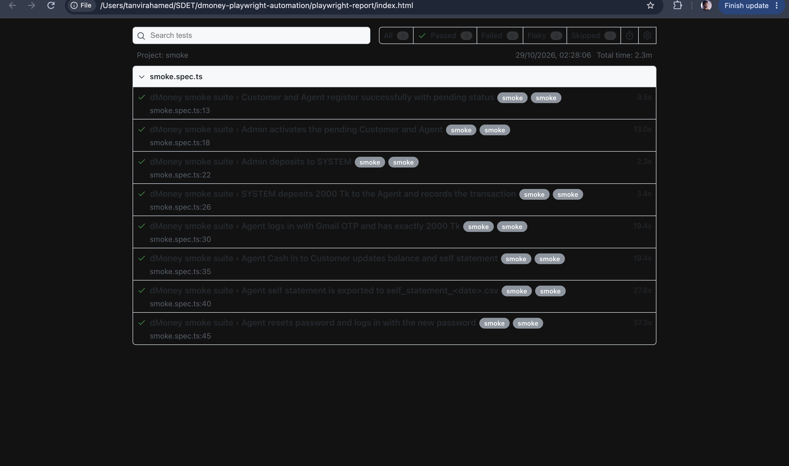
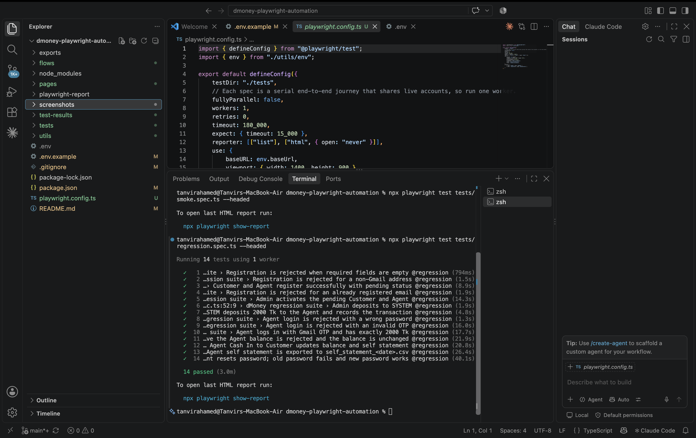

<div align="center">


# 💸 dMoney Playwright E2E Automation Suite

**Comprehensive End-to-End (E2E) automation test suite for the dMoney Web Portal**

Built with 🚀 Playwright + 🟦 TypeScript

</div>

---

> 📌 This suite covers critical functional flows including user registration, admin activation, deposits, Cash In, OTP verification, statement export, and password resets—incorporating actual **Gmail IMAP automation** for verifying dynamic OTPs and reset links.

<div align="center">

### 🎬 Demo & Results

[](https://drive.google.com/file/d/1lyzTW00HS7Ux3JW2U6eJDCXdyx-5kB12/view?usp=sharing)
[](https://drive.google.com/drive/folders/1qEuH8lYWR-X2_R7gCJo0N58sEz5HhDXN?usp=sharing)
[]()
[]()

</div>

---


## 📋 Table of Contents

- [🔍 Project Overview](#-project-overview)
- [🛠️ Technology Stack](#️-technology-stack)
- [⚙️ Prerequisites & Setup](#️-prerequisites--setup)
- [🏃 Running the Tests](#-running-the-tests)
- [📊 Test Execution Results](#-test-execution-results)
- [🗂️ Project Structure](#️-project-structure)
- [🚫 GitIgnore & Organization](#-gitignore--organization)

---

## 🔍 Project Overview

<div align="center">


</div>

This automation framework demonstrates a fully automated SDET capability from end-to-end:

| # | Flow | Description |
|---|------|-------------|
| 🧑‍💼 | **User Onboarding** | Dynamically registers Customer and Agent accounts with unique emails, phones, and NIDs. |
| 🔐 | **Admin Activation** | Logs in as Admin, filters/searches for pending accounts, and activates them. |
| 💰 | **System Deposit** | Logs in as System account and funds the Agent account. |
| 📧 | **Gmail IMAP OTP Verification** | Connects to Gmail via IMAP after Agent login to fetch and fill the live 4-digit OTP. |
| 💵 | **Cash In Transaction** | Agent performs Cash In to the Customer account. |
| 📄 | **Self Statements & CSV Export** | Filters statements by date range and exports the transaction table to a CSV file. |
| 🔑 | **Password Reset Flow** | Triggers password reset, fetches the reset link from Gmail via IMAP, updates the password, and verifies login with new vs. wrong credentials. |

---

## 🛠️ Technology Stack

<div align="center">

| Tool | Purpose |
|------|---------|
|  | Test Harness (TypeScript) |
|  | Runtime Language |
|  | Gmail IMAP + mailparser |
|  | Environment Variables |

</div>

---

## ⚙️ Prerequisites & Setup

### 1️⃣ Clone the Repository

```bash
git clone https://github.com/your-username/dmoney-playwright-automation.git
cd dmoney-playwright-automation
```

### 2️⃣ Install Dependencies

```bash
npm install
npx playwright install
```

### 3️⃣ Configure Environment Variables

Create a `.env` file in the root directory:

```env
# Use the base Gmail account that receives mail for the generated +tag aliases.
GMAIL_USER=your.base.account@gmail.com

# Create a Google app password and keep the real value in the ignored .env file.
GMAIL_APP_PASSWORD=your-16-character-app-password
```

Optional overrides (`BASE_URL`, `ADMIN_EMAIL`, `ADMIN_PASSWORD`, `SYSTEM_EMAIL`, `SYSTEM_PASSWORD`) are listed in `.env.example`; they default to the public dMoney practice values.

---

## 🏃 Running the Tests

Suites are defined as Playwright projects in `playwright.config.ts` and selected by tag.

### 🟢 Smoke Test Suite (`@smoke`, positive flows only)

```bash
npm run test:smoke            # or: npx playwright test --project=smoke
npm run test:smoke:headed     # or: npx playwright test tests/smoke.spec.ts --headed
```

| # | Test |
|---|------|
| 1 | Customer and Agent register successfully (API 201, success toast, redirect to login, `pending` status) |
| 2 | Admin finds both users as **PENDING**, activates them, and the **Active** status persists after a page reload |
| 3 | Admin deposits to SYSTEM (success message + transaction ID) |
| 4 | SYSTEM deposits 2000 Tk to the Agent; the transaction is verified in the SYSTEM self statement |
| 5 | Agent logs in with the Gmail OTP and the balance is exactly **2000.00** Tk |
| 6 | Agent Cash In 500 Tk to the Customer; balance becomes **1512.50** Tk (2.5% commission) and the transaction appears in the Agent self statement |
| 7 | Self statement table is extracted, verified, and saved to `exports/self_statement_<YYYY-MM-DD>.csv` |
| 8 | Agent resets the password through the emailed link and logs in with the new password |

### 🔁 Regression Test Suite (`@regression`, complete suite)

```bash
npm run test:regression       # or: npx playwright test --project=regression
npm run test:regression:headed  # or: npx playwright test tests/regression.spec.ts --headed
```

Runs the full journey above plus the negative checks:

- Registration rejected for empty fields, a non-Gmail address, and an already registered email
- Agent login rejected with a wrong password and with an invalid OTP
- Cash In above the Agent balance rejected with **Insufficient balance**, balance unchanged
- After the password reset, the **old password is rejected** and the new password works

Run both suites with `npm test`, and open the HTML report with `npm run report`.

---

## 📊 Test Execution Results

### 🟢 Smoke Test Result

> **Status:** ✅ **Passed**: 8/8 smoke tests.

### 🔁 Regression Test Result

> **Status:** ✅ **Passed**: 14/14 regression tests.


## 🖼 Verification Screenshots


### 🎥 Video Demonstration

> **Headed Automation Recording:** 📹 [Watch Full Video on Google Drive](https://drive.google.com/file/d/1lyzTW00HS7Ux3JW2U6eJDCXdyx-5kB12/view?usp=sharing)


### HTML Test Report



---

## 🗂️ Project Structure

```
📦 dmoney-playwright-automation
├── 📂 tests/
│   ├── 📄 smoke.spec.ts                     # @smoke: positive critical flows
│   └── 📄 regression.spec.ts                # @regression: full journey + negative cases
├── 📂 flows/
│   └── 📄 journey.ts                        # Shared journey steps and assertions used by both suites
├── 📂 pages/                                # Page objects (role/label-based locators)
│   ├── 📄 BasePage.ts
│   ├── 📄 RegisterPage.ts  📄 LoginPage.ts  📄 ProfilePage.ts
│   ├── 📄 UserListPage.ts  📄 UserDetailsPage.ts  📄 AdminDepositPage.ts
│   ├── 📄 CashInPage.ts    📄 SelfStatementPage.ts
│   └── 📄 ForgotPasswordPage.ts  📄 ResetPasswordPage.ts
├── 📂 utils/
│   ├── 📄 env.ts                            # .env loading and defaults
│   ├── 📄 gmail.ts                          # IMAP helpers: OTP and reset-link lookup
│   ├── 📄 testData.ts                       # Unique users, amounts, money formatting
│   └── 📄 files.ts                          # Dates and CSV writer
├── 📂 exports/                              # Generated self_statement_<date>.csv (ignored)
├── 📄 playwright.config.ts                  # Playwright configuration (smoke / regression projects)
├── 📄 .env.example                          # Template for the local .env
└── 📄 README.md                             # Project documentation
```

---

## 🚫 GitIgnore & Organization

The following necessary files and folders are ignored via `.gitignore`:

| Path | Description |
|------|-------------|
| 📁 `node_modules/` | Installed dependencies |
| 📁 `test-results/` | Raw test artifacts |
| 📁 `playwright-report/` | HTML test report |
| 📁 `blob-report/` | Blob report output |
| 📄 `.env` | Local environment variables |
| 📁 `exports/`, 📄 `*.csv` | Generated self statement CSV exports |

---

<div align="center">

### 👤 Author

**Md Tanvir Ahamed**

✉️ [ahamedtanvir93@gmail.com](mailto:ahamedtanvir93@gmail.com)

---

*Built with ❤️, 🚀 Playwright, and 🟦 TypeScript*

</div>
